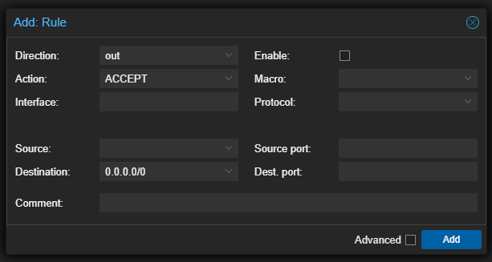
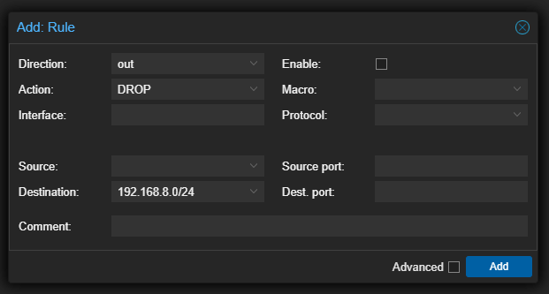
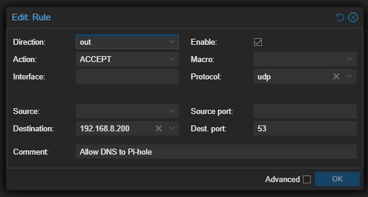
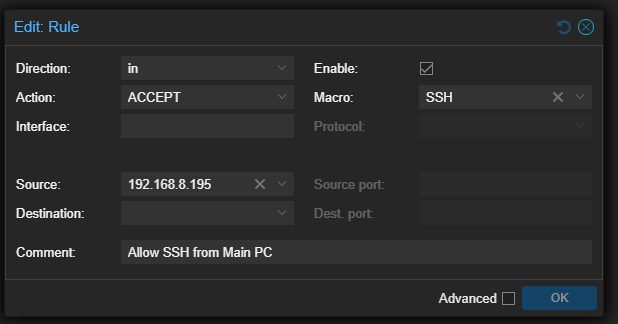
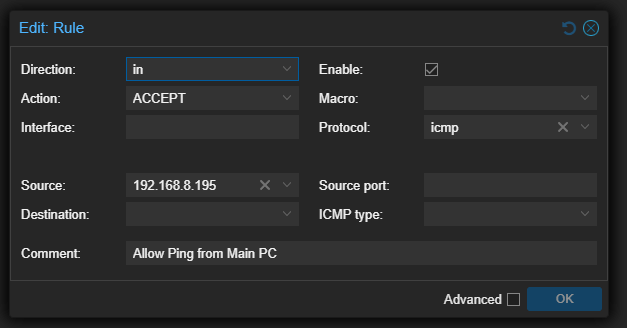
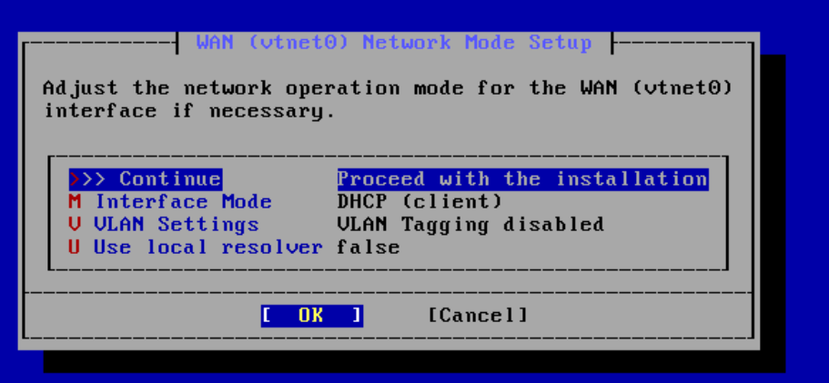
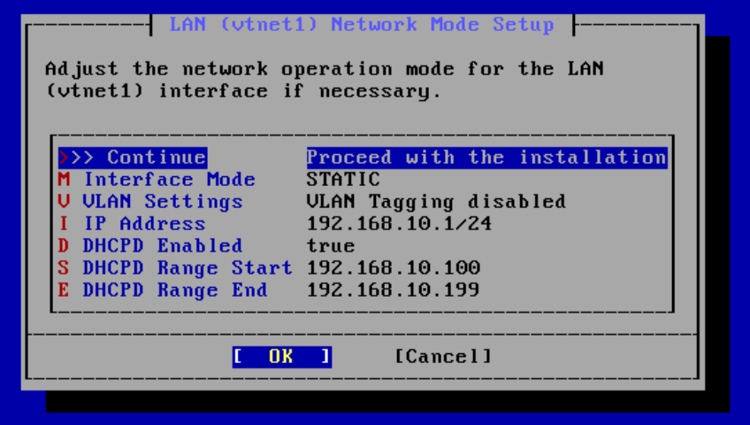
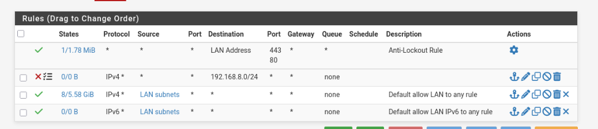

# 01 – Proxmox Virtualization & Storage Optimization

Building the hypervisor layer: a bare-metal Proxmox VE host with mirrored ZFS storage, a pfSense gateway that carves out an isolated SOC range, and per-VM firewall rules that enforce zero-trust between lab guests and the home network.

---

## 1. Host Preparation

| Item | Choice | Why |
|---|---|---|
| Disks | 1× M.2 SSD (Windows 11) + 2× 2.5" SSD (Proxmox) | Keeps the daily-driver OS and the hypervisor physically separate |
| Filesystem | **ZFS RAID 1 (mirror)** | A single SSD failure does not take the lab down |
| CPU feature | **Intel VT-x (VMX)** enabled in BIOS | Proxmox is a Type-1 hypervisor; without VT-x it falls back to slow software emulation and many guests fail to boot |
| Host IP | Static `192.168.8.31/24` | DHCP lease changes would break bookmarks, SSH configs and firewall rules |

**Steps**
1. Enable VT-x in BIOS.
2. Hide the disks from each other so neither installer touches the other OS:
   `diskpart` → `list disk` → `select disk N` → `offline disk`.
3. Flash the Proxmox VE ISO to USB with Rufus and boot it.
4. In the installer, click **Options** on the disk screen and change the filesystem from `ext4` to **ZFS (RAID1)**.
5. Set the static management IP during install so nothing needs to change later.

---

## 2. Standard VM Template

Every Linux guest follows the same baseline:

| Setting | Value | Reason |
|---|---|---|
| BIOS | OVMF (UEFI) preferred over SeaBIOS | Modern firmware |
| QEMU Guest Agent | On | Clean shutdowns; host can read guest IPs |
| Disk | 32 GiB, **Discard** checked | TRIM tells the SSD which blocks are free |
| CPU | 4 cores, type `host` | Exposes real CPU flags to the guest |
| Memory | 4096 MiB | |
| Network | `vmbr0`, model **VirtIO (paravirtualized)** | Highest throughput |

---

## 3. Zero-Trust Firewall for Untrusted VMs

**Problem:** a test VM on `vmbr0` could reach the Proxmox host and every device on the home LAN. If the workload were compromised, it could pivot.

**Root cause:** Proxmox VMs share the bridge with no filtering by default.

**Fix:** enable the firewall at the Datacenter, VM and NIC (`net0`) levels, then build an ordered rule stack. Order matters: the first match wins, so the specific exceptions go **above** the broad drop.

| # | Direction | Action | Destination / Source | Purpose |
|---|---|---|---|---|
| 1 | out | ACCEPT | dest `192.168.8.200` UDP 53 | DNS to Pi-hole (exception) |
| 2 | out | DROP | dest `192.168.8.0/24` | Block all other LAN traffic |
| 3 | out | ACCEPT | dest `0.0.0.0/0` | Internet access |
| 4 | in | ACCEPT (SSH macro) | src Main PC | Admin access |
| 5 | in | ACCEPT (ICMP) | src Main PC | Health checks |

> The DNS exception was added after troubleshooting a name-resolution failure — see [Troubleshooting](05-troubleshooting-playbooks.md#1-vm-could-ping-but-not-resolve-dns).

---

## 4. pfSense Gateway & Isolated SOC Range

pfSense sits between the two Linux bridges and acts as the router, DHCP server and firewall for the lab.

| Bridge | Role | Network |
|---|---|---|
| `vmbr0` | WAN – home network | `192.168.8.0/24` (pfSense WAN `192.168.8.184`) |
| `vmbr1` | LAN – isolated SOC range | `192.168.10.0/24` (pfSense LAN `192.168.10.1`) |

**VM settings:** 16 GiB disk (Discard + IO Thread), 1 socket / 2 cores, 2 GB RAM.

**Creating `vmbr1`:** *Node → System → Network → Create → Linux Bridge*, name only, no firewall. Add it to the pfSense VM as a second network device after install.

**Installer:** `vmbr0` = WAN (DHCP client), `vmbr1` = LAN (static `192.168.10.1/24`, DHCP range `.100`–`.199`). ZFS redundancy is not used inside the VM because the host already mirrors the disk.

**How traffic flows:** lab VMs use `192.168.10.1` as their default gateway. pfSense applies **Outbound NAT**, rewriting the source to its WAN address and forwarding to the home router — the same job VirtualBox NAT would normally do, but under my control.

**Lateral-movement block:** a LAN rule blocks the SOC range from reaching the home subnet `192.168.8.0/24`, while the default *allow LAN to any* rule still permits internet access.

---

## 5. Lab Virtual Machines

| VM | OS | vCPU / RAM / Disk | IP (`vmbr1`) |
|---|---|---|---|
| Active-Directory-DC | Windows Server 2022 | 2 / 4 GB / 32 GiB, TPM | `192.168.10.102` |
| Target-Machine | Windows 10 Enterprise | 2 / 4 GB / 32 GiB, TPM | `192.168.10.101` (DHCP) |
| Splunk-Server | Ubuntu Server (q35) | 4 / 4 GB / 80 GiB | `192.168.10.103` |
| Attacker-Machine | Kali Linux | 2 / 3 GB / 40 GiB | `192.168.10.100` |

> Take a Proxmox **snapshot** after the domain is built — it makes attack-and-reset cycles painless.

---

## 6. Windows VirtIO Storage Optimization

Windows guests showed **~80% IO delay** on SATA emulation. Moving to VirtIO SCSI fixed it, but a naive switch causes `INACCESSIBLE_BOOT_DEVICE`. The full fix is in [Troubleshooting](05-troubleshooting-playbooks.md#2-windows-io-delay--inaccessible_boot_device).

Final Windows VM settings:
- QEMU Guest Agent enabled (VM → Options)
- Disk on **SCSI (VirtIO SCSI single)**, Discard + IO Thread
- NIC model changed from Intel E1000 to **VirtIO**
- `scsi0` first in boot order

**Quality-of-life:** clipboard sharing via SPICE display + `spice-vdagent` (Linux) or SPICE Guest Tools (Windows).
