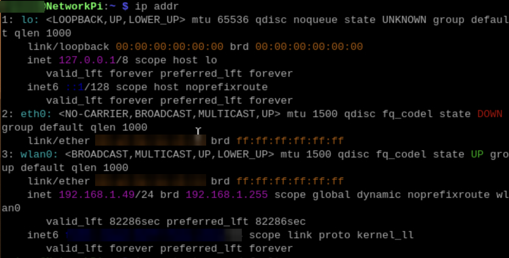
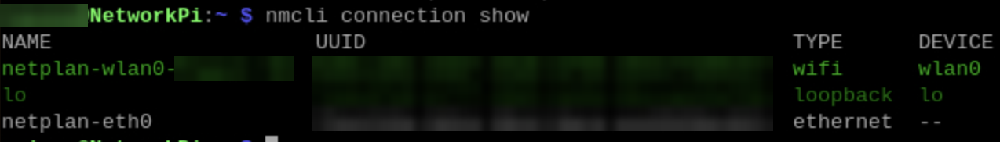
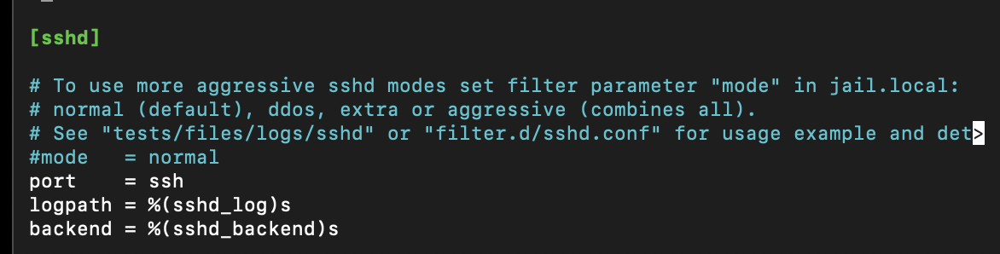
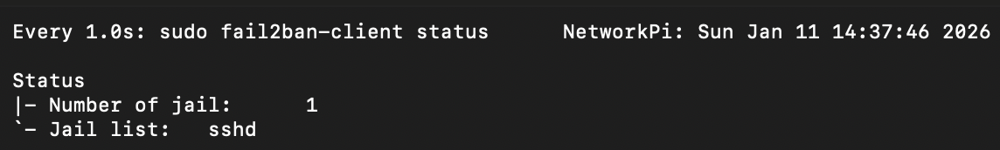
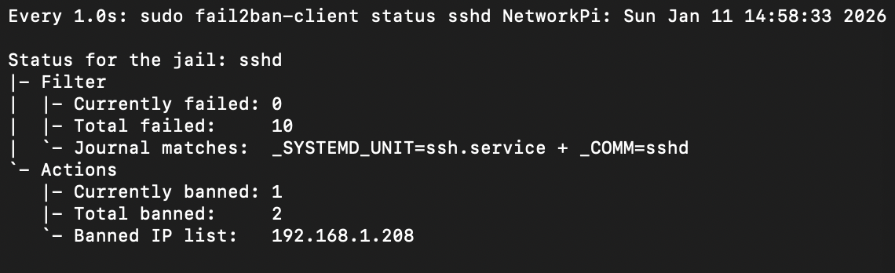
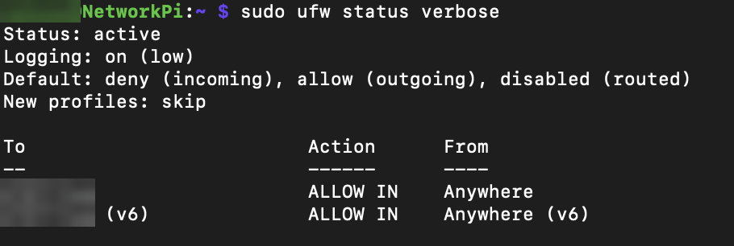
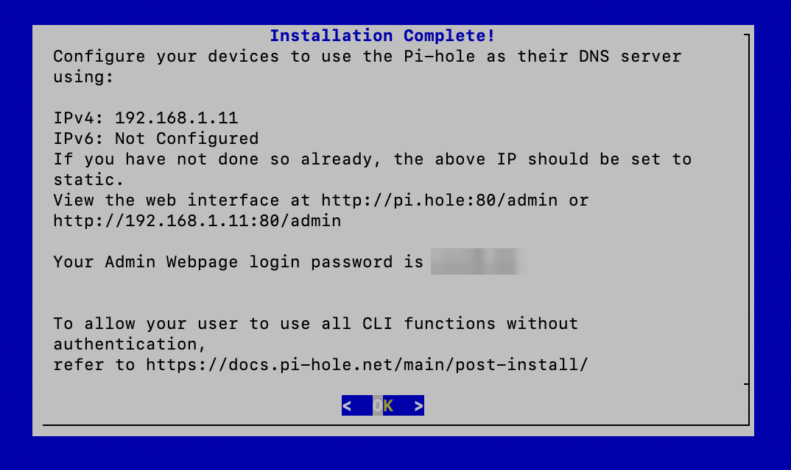
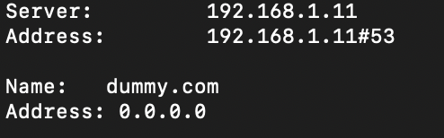
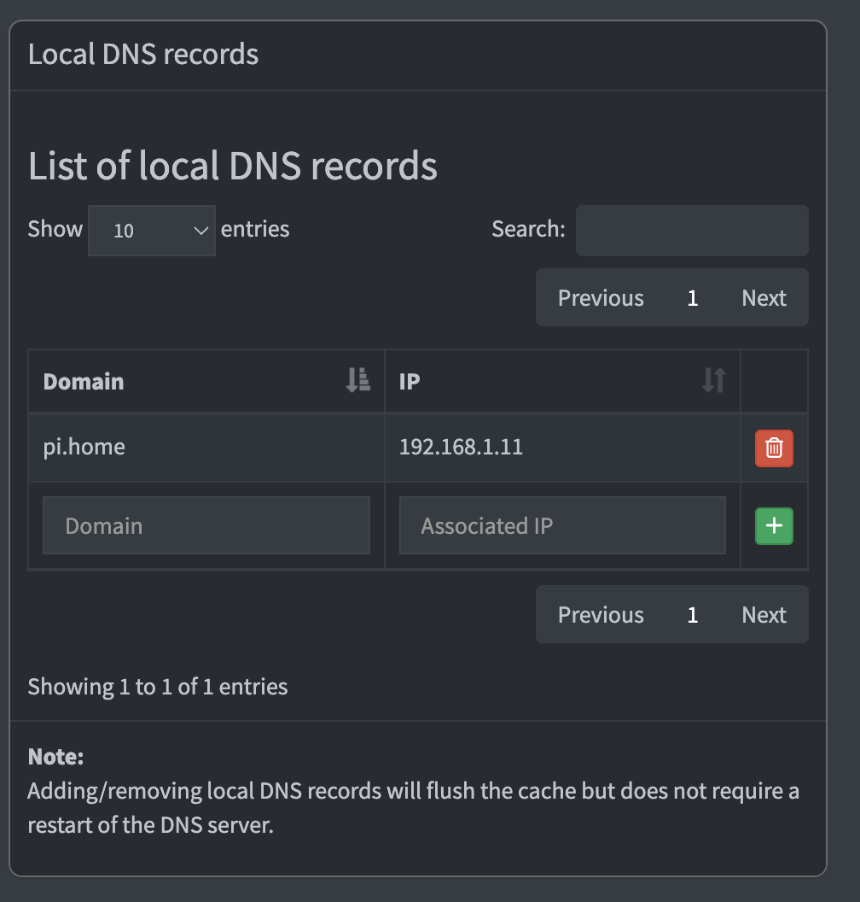
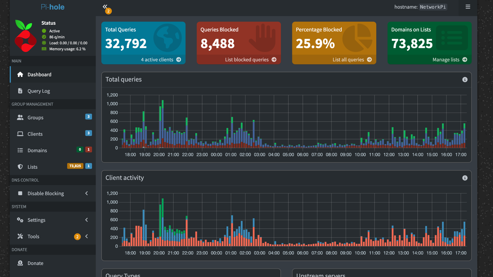

# 02 – Network Pi & Boundary Hardening

A bare-metal Raspberry Pi ("NetworkPi") serves as the network's DNS sinkhole and is hardened as if it were internet-facing: key-only SSH on a non-standard port, Fail2ban intrusion prevention, and a default-deny UFW firewall.

> Values such as `YOUR_USER`, `<CUSTOM_SSH_PORT>` and `YOUR_PASSWORD` are placeholders.

---

## Task 1 – Static IP

A DNS server must never change address, or every client loses name resolution.

```bash
# Discover the current address, gateway and connection name
ip addr
ip route show default
nmcli connection show
```





Pick an address outside the router's DHCP pool and match the router's `/24` mask (24 bits of network, 8 bits = 256 host addresses).

```bash
# Current deployment (wired)
sudo nmcli connection modify "Wired connection 1" ipv4.addresses 192.168.8.200/24
sudo nmcli connection modify "Wired connection 1" ipv4.gateway 192.168.8.1
sudo nmcli connection modify "Wired connection 1" ipv4.dns "1.1.1.1,8.8.8.8"
sudo nmcli connection modify "Wired connection 1" ipv4.method manual
sudo nmcli connection up "Wired connection 1"

# Verify
hostname -I
ping -c 4 192.168.8.1
ping -c 4 google.com
```

> The Pi was first built on a different network (`192.168.1.11`), which is why some screenshots show that address. After moving it, `pihole -r` repairs Pi-hole's stored IP.

---

## Task 2 – SSH Hardening

**Goal:** stop password brute-forcing entirely.

1. On the **client** (not the Pi), generate a modern key and copy it over:
   ```bash
   ssh-keygen -t ed25519 -C "you@example.com"
   ssh-copy-id YOUR_USER@192.168.8.200
   ```
2. Edit `/etc/ssh/sshd_config`:

   | Setting | Before | After | Why |
   |---|---|---|---|
   | `PasswordAuthentication` | `#… yes` | `no` | Private key required |
   | `PermitRootLogin` | `#… prohibit-password` | `no` | No direct root logins |
   | `Port` | `#Port 22` | `<CUSTOM_SSH_PORT>` | Drops noise from bots that only scan 22 (use 1024–49151) |
   | `UsePAM` | `yes` | `no` | PAM was overriding the hardening |

3. `sudo systemctl restart ssh`

**Verification**

| Test | Expected |
|---|---|
| `ssh -p <CUSTOM_SSH_PORT> YOUR_USER@<pi-ip>` | Logs in with key |
| `ssh -p <CUSTOM_SSH_PORT> -o PubkeyAuthentication=no YOUR_USER@<pi-ip>` | **Denied** |
| `ssh -p <CUSTOM_SSH_PORT> root@<pi-ip>` | **Denied** (no password prompt) |
| `ssh -p 22 YOUR_USER@<pi-ip>` | Connection refused |

> **Finding:** a leftover `50-cloud-init.conf` in `/etc/ssh/sshd_config.d/` re-enabled password login and silently overrode the hardening. See [Troubleshooting](05-troubleshooting-playbooks.md#3-ssh-hardening-silently-overridden).

**Convenience:** a `~/.ssh/config` entry turns the long command into `ssh networkpi`:

```
Host networkpi
    HostName 192.168.8.200
    User YOUR_USER
    Port <CUSTOM_SSH_PORT>
    IdentityFile ~/.ssh/id_ed25519
    AddKeysToAgent yes
    UseKeychain yes
```

---

## Task 3 – Fail2ban (Intrusion Prevention)

```bash
sudo apt install fail2ban -y
# Never edit jail.conf directly; jail.local overrides it and survives updates
sudo cp /etc/fail2ban/jail.conf /etc/fail2ban/jail.local
sudo nano /etc/fail2ban/jail.local
```

Final `[sshd]` jail (also in [`configs/fail2ban/jail.local`](../configs/fail2ban/jail.local)):

```ini
[sshd]
enabled  = true
port     = <CUSTOM_SSH_PORT>
mode     = aggressive
maxretry = 3
findtime = 10m
bantime  = 2m
logpath  = %(sshd_log)s
backend  = %(sshd_backend)s
```

- `maxretry` + `findtime`: 3 failures within 10 minutes → ban.
- `mode = aggressive` is required because password logins are already disabled. In `normal` mode Fail2ban only counts bad passwords, so key-only attackers were never banned.




**Verification:** three failed SSH attempts from another host → that IP appears in the banned list.

```bash
watch -n 1 sudo fail2ban-client status sshd
sudo fail2ban-client set sshd unbanip <IP_ADDRESS>   # if you lock yourself out
```



---

## Task 4 – UFW (Default-Deny Firewall)

```bash
sudo apt install ufw -y
sudo ufw default deny incoming
sudo ufw default allow outgoing
sudo ufw allow <CUSTOM_SSH_PORT>/tcp   # open SSH BEFORE enabling, or you lock yourself out
sudo ufw allow 53/tcp                  # DNS
sudo ufw allow 53/udp
sudo ufw allow 80/tcp                  # Pi-hole dashboard
sudo ufw allow 443/tcp
sudo ufw enable
sudo ufw status verbose
```



---

## Task 5 – Pi-hole (DNS Sinkhole)

```bash
curl -sSL https://install.pi-hole.net | bash
```

Installer choices:
- **StevenBlack Unified Hosts** list — 100k+ ad, tracker and malware domains. Matches resolve to `0.0.0.0`, so the request dies before it leaves the network.
- **FTL privacy mode: show everything** — every query is logged, which is useful for troubleshooting and for spotting devices "phoning home".
- Upstream DNS: Cloudflare / Google.



The generated admin password is replaced right away with `sudo pihole setpassword`. Clients (Proxmox, the main PC, phones) are pointed at the Pi for DNS.

**Verification:** add a test domain to the blocklist and query it — the sinkhole answers `0.0.0.0`.



A local DNS record (`pi.home`) gives the dashboard a friendly name:



**Result:** ~26% of all DNS queries on the network are blocked.



---

## Task 6 – Tailscale (Remote Access)

```bash
curl -fsSL https://tailscale.com/install.sh | sh
sudo tailscale up     # open the printed URL to authenticate
```

**Verification:** from a second device on a different network (e.g. mobile data), ping the Pi's Tailscale address. Replies prove the encrypted tunnel works — with no ports opened on the home router.
