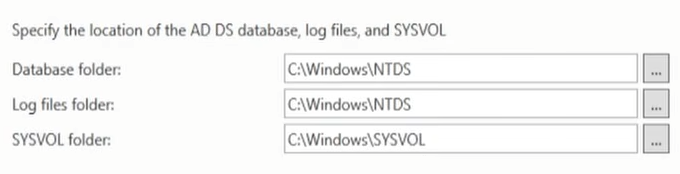
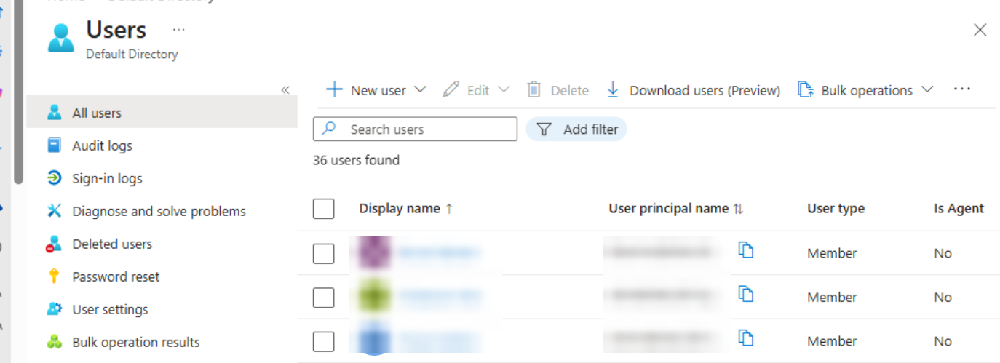
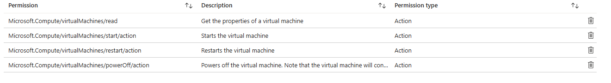
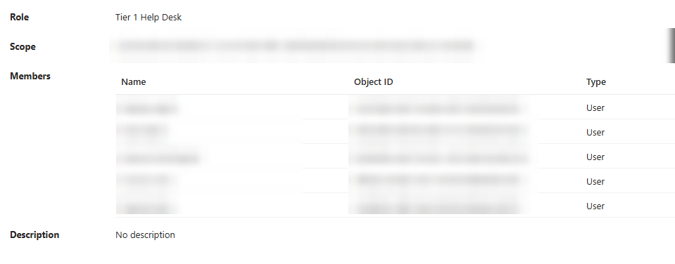

# 03 – Active Directory & Hybrid Cloud IAM

An on-prem Windows Server 2022 domain controller, populated by PowerShell, synchronized to Microsoft Entra ID, with least-privilege custom Azure RBAC roles — plus the telemetry pipeline that feeds both SIEMs.

> The lab domain is shown as `lab.local`. Secrets are placeholders (`YOUR_DOMAIN_ADMIN_PASSWORD`, `YOUR_TENANT`).

---

## 1. Promote the Domain Controller

1. *Server Manager → Manage → Add Roles and Features*
2. Role-based installation → select the local server → **Active Directory Domain Services**
3. Use the flag notification to **Promote this server to a domain controller**
4. **Add a new forest** → root domain `lab.local` → set the DSRM password

The AD DS database (`NTDS.dit`) and SYSVOL hold every object in the domain, including password hashes. Anyone who can read these files effectively owns the domain, so they stay in their protected default paths.



---

## 2. Populate the Directory with PowerShell

Instead of clicking through ADUC, two scripts build a realistic company structure:

| Script | What it does |
|---|---|
| [`scripts/Populate-ADUsers.ps1`](../scripts/Populate-ADUsers.ps1) | Creates a parent OU `Corp_OUs`, 7 department OUs, and 33 users with titles and UPNs. Safe to re-run (skips anything that exists). Prompts for the initial password instead of hard-coding it. |
| [`scripts/Set-UserDepartments.ps1`](../scripts/Set-UserDepartments.ps1) | Walks each department OU and stamps the `Department` attribute on its members, then triggers an Entra delta sync. |

```
lab.local
└── Corp_OUs
    ├── Legal
    ├── Creative_PR
    ├── Marketing
    ├── Media
    ├── HR
    ├── Engineering
    ├── Executive
    └── IT          (added later for the help-desk RBAC scenario)
```

---

## 3. Join the Target Machine to the Domain

1. On the Windows 10 VM set **DNS to the DC** (`192.168.10.102`). Without this the client cannot locate the domain.
2. *Advanced System Settings → Computer Name → Change* → domain `lab.local` → domain admin credentials → reboot.
3. Enable RDP for the domain users (needed later for the attack simulation).

---

## 4. Hybrid Identity – Microsoft Entra Connect Sync

**Azure groundwork**

| Resource | Value |
|---|---|
| Resource group | `Hybrid-Homelab` (US East) |
| VNet | `AzureNetwork`, `10.0.0.0/16` |
| Workload subnet | `10.0.2.0/24` |
| GatewaySubnet | `10.0.1.0/24` (reserved for the site-to-site VPN gateway) |

**Install (on the DC):** Entra Admin Center → *Hybrid management → Microsoft Entra Connect → Connect Sync* → download `AzureADConnect.msi`.

Express settings failed to sync anything, so I used **Customize**:

| Wizard page | Choice | Why |
|---|---|---|
| User sign-in | **Password Hash Synchronization** | Users sign in to cloud apps with the same credentials as their workstation |
| Entra tenant | `YOUR_TENANT.onmicrosoft.com` | Default cloud domain |
| AD connector account | **Create new AD account** | Least privilege — the sync engine should not run as Domain Admin |
| UPN suffix | Continue without matching all suffixes | `.local` is not a routable, verifiable domain |
| Domain/OU filtering | Sync **selected** OUs only | Keeps built-in containers out of the cloud |

**Verification:** *Entra → Users → All users* shows the on-prem accounts with **On-premises sync enabled = Yes**.



**How authority flows:** on-prem AD → Entra ID only. A password change on-prem syncs up to the cloud. Resetting a password in the cloud and pushing it down would require *Password Writeback*, which is not enabled.

---

## 5. Least-Privilege Azure RBAC – "Tier 1 Help Desk"

A custom role lets help-desk staff keep VMs running without being able to change or delete infrastructure.

*Subscription → Access control (IAM) → Add custom role → Start from scratch*

| Permission | Allows |
|---|---|
| `Microsoft.Compute/virtualMachines/read` | View VM status |
| `Microsoft.Compute/virtualMachines/start/action` | Power on |
| `Microsoft.Compute/virtualMachines/restart/action` | Restart |
| `Microsoft.Compute/virtualMachines/powerOff/action` | Power off |



The role is assigned **at the resource-group scope** to members of the IT department.



---

## 6. Dual-SIEM Telemetry Pipeline

### On-prem: Splunk Enterprise

**Splunk server (Ubuntu, `192.168.10.103`)**
```bash
wget -O splunk.deb "PASTE_SPLUNK_DOWNLOAD_URL_HERE"
sudo dpkg -i splunk.deb
sudo /opt/splunk/bin/splunk start --accept-license
sudo /opt/splunk/bin/splunk enable boot-start -user splunk
```
In Splunk Web (`:8000`): create index **`endpoint`** and a receiving port **9997**.

**Each Windows host (DC and Target)**
1. Install the **Splunk Universal Forwarder** → receiving indexer `192.168.10.103:9997`.
2. Install **Sysmon** with Olaf Hartong's community config:
   ```powershell
   .\Sysmon64.exe -accepteula -i ..\sysmonconfig.xml
   ```
3. Create `C:\Program Files\SplunkUniversalForwarder\etc\system\local\inputs.conf` — never edit the copy in `default\`. See [`configs/splunk/inputs.conf`](../configs/splunk/inputs.conf).
4. Set the *SplunkForwarder* service to log on as **Local System** (needed to read the Security log), then restart it.
5. Verify in Search: `index="endpoint"`.

### Cloud: Microsoft Sentinel

1. Create Log Analytics workspace `Log-Analytics-Sentinel` and enable **Microsoft Sentinel** on it.
2. Onboard the Windows hosts with **Azure Arc** (*Machines → Onboard existing machine* → run the generated script).
3. Content Hub → **Windows Security Events** → *Windows Security Events via AMA* connector.
4. Data Collection Rule `High-Value-Telemetry` with a custom XPath filter, so only the events that matter are ingested (which also saves credits):

```
Security!*[System[(EventID=4624 or EventID=4625 or EventID=4720 or EventID=4740)]]
```

| Event ID | Meaning |
|---|---|
| 4624 | Successful logon |
| 4625 | Failed logon |
| 4720 | User account created |
| 4740 | Account locked out |
