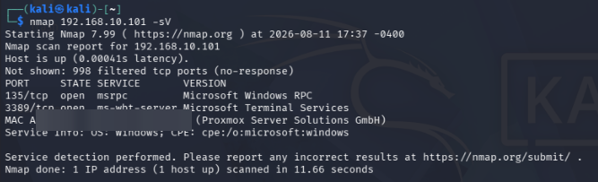
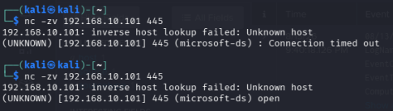
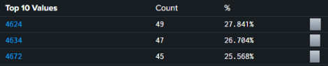

# 04 – Threat Emulation & Detection Triage

This module covers the **blue-team side** of the lab: confirming that adversary activity against the isolated range shows up in the SIEMs, and triaging it by Event ID.

> All testing was performed only inside my own isolated lab network (`192.168.10.0/24`). Lab account names and wordlists are not included.

---

## 1. Detection Loop

**Simulate activity → Generate telemetry → Query SIEM → Find gaps → Tune**

| MITRE ATT&CK | Technique | Lab activity | Expected telemetry |
|---|---|---|---|
| T1046 | Network Service Discovery | Service scan of the Windows target from Kali | Firewall / connection logs |
| T1110 | Brute Force | Repeated authentication attempts over RDP and SMB against a lab domain user | 4625 bursts, then 4624 / 4740 |
| Various | Atomic Red Team tests | Scripted, ATT&CK-mapped behaviors on the target | Sysmon + Security events |

---

## 2. Visibility Checks

Before the SIEM could see anything, the target had to actually be reachable. Initial scans showed only RPC and RDP, because the Windows Firewall filtered SMB and ICMP on the active network profile.



After the firewall fix in [Troubleshooting](05-troubleshooting-playbooks.md#5-no-authentication-telemetry-in-the-siem), a port check confirmed SMB went from *timed out* to *open*:



---

## 3. Triage in Splunk

Key Windows Security Event IDs:

| Event ID | Meaning | What it tells the analyst |
|---|---|---|
| **4625** | Failed logon | Many from one source in a short window = brute force |
| **4624** | Successful logon | A 4624 right after a burst of 4625s = likely compromised credentials |
| **4720** | User account created | Possible persistence |
| **4740** | Account locked out | Lockout policy fired — confirms the attack and its target |
| 4634 / 4672 | Logoff / special privileges assigned | Session context and admin logons |

**Example searches**

```spl
index=endpoint EventCode=4625
| stats count by Source_Network_Address, Account_Name
| sort - count
```

```spl
index=endpoint (EventCode=4625 OR EventCode=4624)
| bin _time span=5m
| stats count(eval(EventCode=4625)) as failures count(eval(EventCode=4624)) as successes by _time, Account_Name
| where failures > 5 AND successes > 0
```

```spl
index=endpoint EventCode=4740
```

Top event codes during a test window:



The same 4624 / 4625 / 4720 / 4740 events are forwarded to **Microsoft Sentinel** through the `High-Value-Telemetry` Data Collection Rule, so both SIEMs can be compared side by side.

---

## 4. Lessons Learned

- **No telemetry does not mean no attack.** The first test runs produced zero 4625 events. The cause was network reachability and tooling, not missing detections — see [Troubleshooting](05-troubleshooting-playbooks.md).
- **Account lockout checks** (`Get-ADUser <user> -Properties LockedOut, BadLogonCount`) quickly confirm whether domain policy is interfering with a test.
- **Accurate timestamps are essential** for correlating events across hosts — see the time-zone fix in Troubleshooting.
