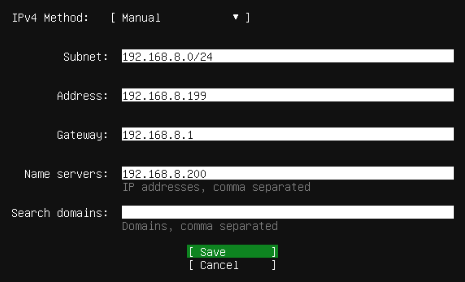

# 06 – Containerized Services

A dedicated Ubuntu Server VM hosts Docker workloads (starting with Jellyfin), kept separate from the security lab on `vmbr1`.

---

## 1. Docker Host VM

| Tab | Setting | Value | Why |
|---|---|---|---|
| General | Name / Start at boot | `docker-services` / ✔ | Services come back after a host reboot |
| OS | ISO | Ubuntu Server 24.04 | |
| System | SCSI controller | **VirtIO SCSI single** | Dedicated IO threads, so disk work doesn't block the host CPU |
| System | Machine | q35 | Leaves the door open for GPU passthrough (hardware transcoding) |
| System | QEMU Agent | ✔ | Clean shutdowns; guest IP shown in Proxmox |
| Disks | Size / Cache | 30–40 GiB / Write back | Room for images and container data |
| Disks | IO Thread, Discard, SSD emulation | ✔ ✔ ✔ | Performance + TRIM |
| CPU | 1 socket × 2 cores, type `host` | | |
| Memory | 4096 MiB, ballooning min 2048 | | Returns unused RAM to the host |
| Network | `vmbr0`, VirtIO | | |

Static addressing during install (DNS via the Pi-hole):



| Field | Value |
|---|---|
| Address | `192.168.8.199/24` |
| Gateway | `192.168.8.1` |
| DNS | `192.168.8.200` (Pi-hole) |

---

## 2. Jellyfin

Jellyfin runs as a container on the Docker host and is published on port **8096** (see the architecture diagram). An example deployment:

```bash
# Install Docker Engine (official convenience script)
curl -fsSL https://get.docker.com | sh

# Run Jellyfin with persistent config and a media folder
docker run -d \
  --name jellyfin \
  --restart unless-stopped \
  -p 8096:8096 \
  -v /srv/jellyfin/config:/config \
  -v /srv/media:/media \
  jellyfin/jellyfin
```

---

## 3. Roadmap

- GPU passthrough for hardware transcoding
- TrueNAS VM as network-attached storage for media
- Move service containers onto their own segmented bridge/VLAN
